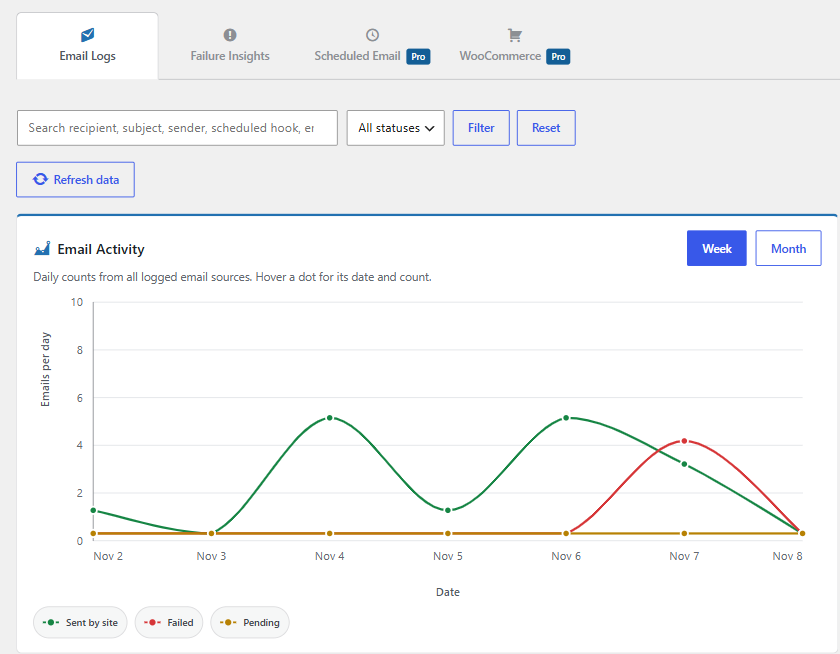
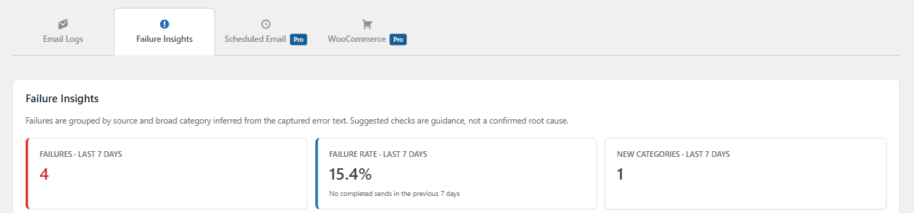

# Dashboard and Reports

The dashboard lists recent email attempts and provides search, status filters, source filters, and CSV export. Full message details are loaded when you open an individual log.

## Email activity

The Email Activity chart shows daily sent, failed, and pending counts for the selected week or month. The weekly and monthly reports summarize activity over their respective periods.

Failure Insights groups recent failures by source and broad patterns inferred from captured error text. Its suggested checks are guidance, not a confirmed diagnosis.

## CSV export and deletion

Use **Export All CSV** to download logs. Treat exports as sensitive because they may contain email addresses, subjects, message bodies, and diagnostic details captured under your settings. Delete individual logs or use **Delete All Logs** to erase the history.

## Pro reports

Eligible Pro licenses may also show six-week email reports, Scheduled Email reporting, WooCommerce analytics, and email open activity. Availability depends on license entitlement and the relevant feature settings.